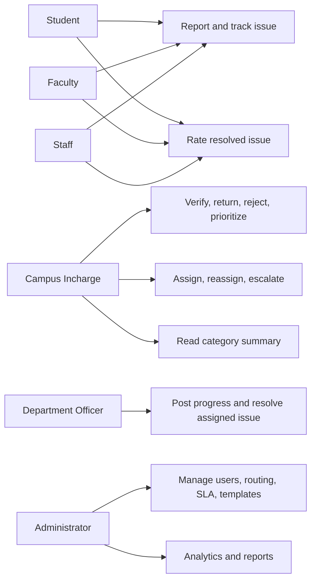
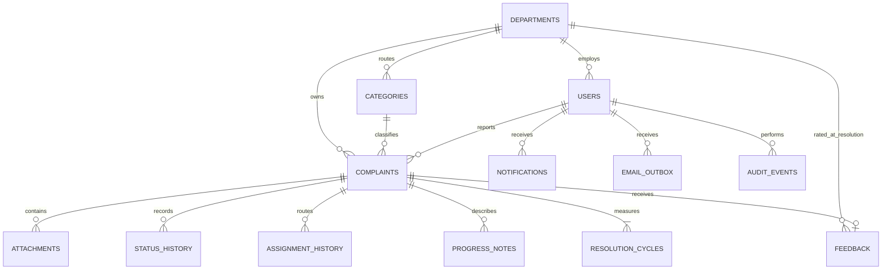
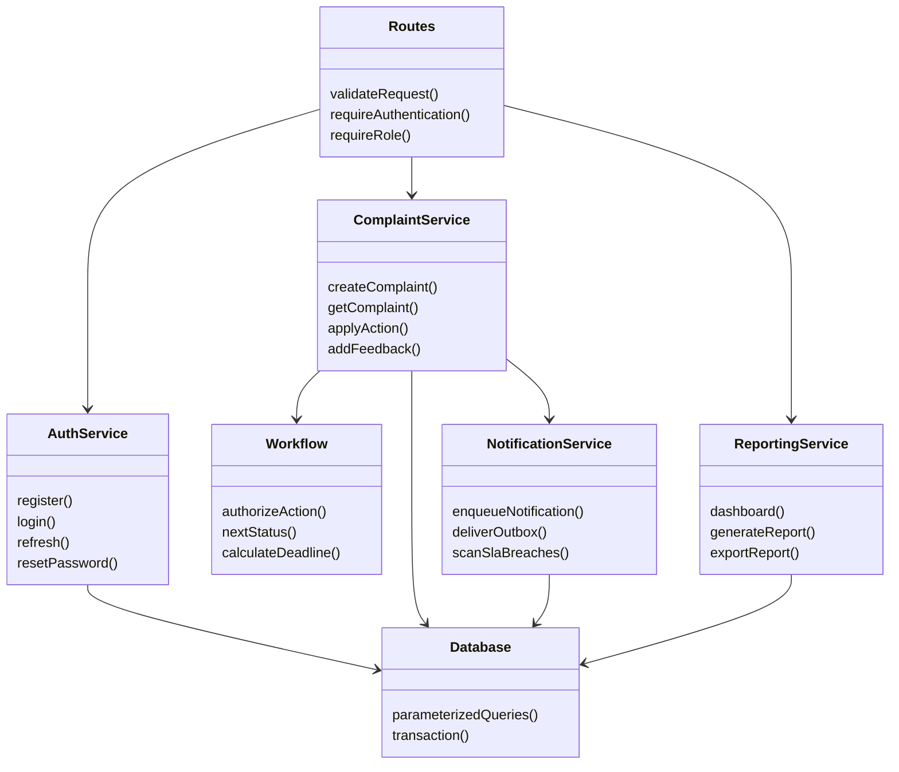
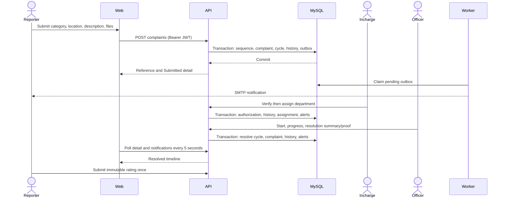
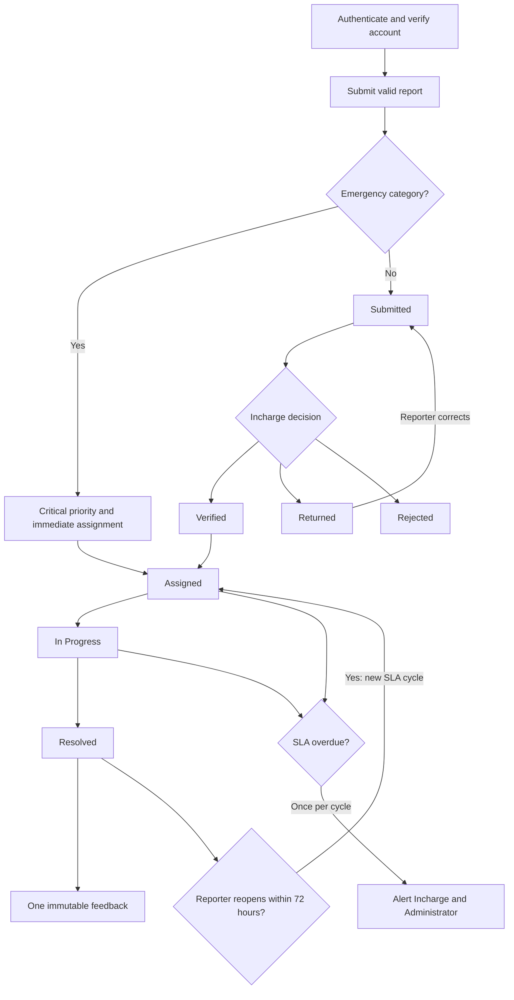
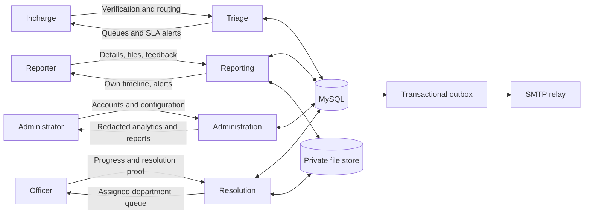

# FixMyCampus architecture

The browser uses a versioned Express JSON API and Bearer access JWTs. The API uses parameterized MySQL queries and transactions. Private files are streamed only after complaint authorization. A transactional outbox separates successful complaint writes from SMTP delivery. The API process runs the outbox and SLA workers; database locking prevents duplicate job effects.

## Use cases

## Entity relationships

Roles are constrained values on users, not a separate mutable role table. All times are UTC. Complaint references use the IST submission date.

SLA setting values are copied into each resolution cycle, rather than linked by a foreign key, so later configuration edits do not rewrite historical deadlines.

## Service responsibilities

The implementation uses TypeScript modules with exported functions; this responsibility diagram does not imply class instances or an ORM.

## Ordinary complaint sequence

## Workflow activity

## Context and data flow

## Privacy and correctness boundaries

- Students, Faculty, and Staff see their own complaints. Officers see their assigned department. Incharge handles triage. Administrators receive aggregate confidential information rather than confidential case details.
- Mental Health and Anti-Ragging reporter names are hidden only when the reporter selects anonymous submission. Authentication and internal ownership remain intact. Descriptions and uploaded file contents are authored by the reporter and may themselves contain identity details.
- Read authorization applies consistently to detail, list/search, attachment streams, notifications, dashboards, and exports. Client-side hiding is never the authorization boundary.
- History, prior resolution proof, assignment history, audit records, and historical SLA snapshots are retained. Complaint deletion is not exposed. Reopening creates a new cycle and does not erase previous resolution data.
- Supported deployment is one campus and one application instance. Local files must be shared or replaced with private Cloudinary storage before adding replicas. Production TLS and SMTP delivery depend on deployment configuration.
